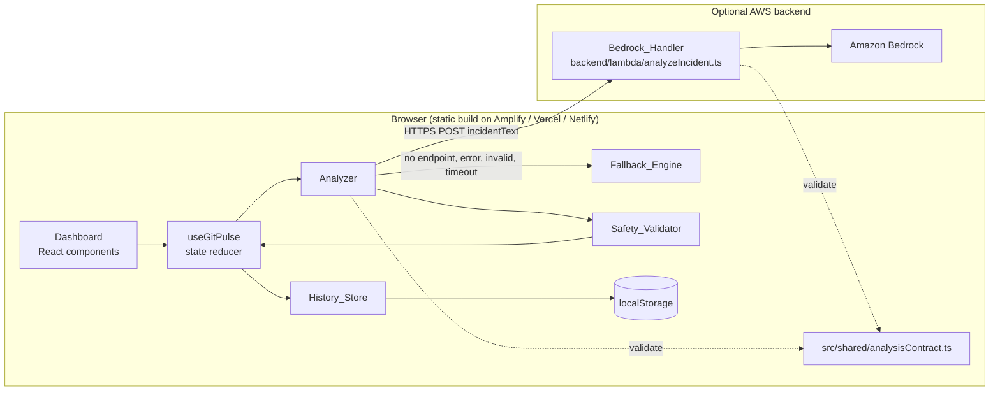
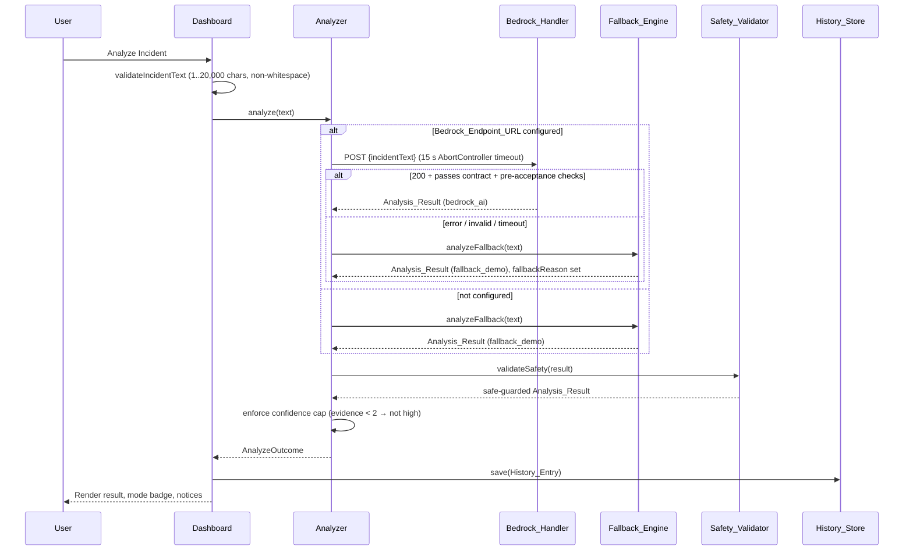
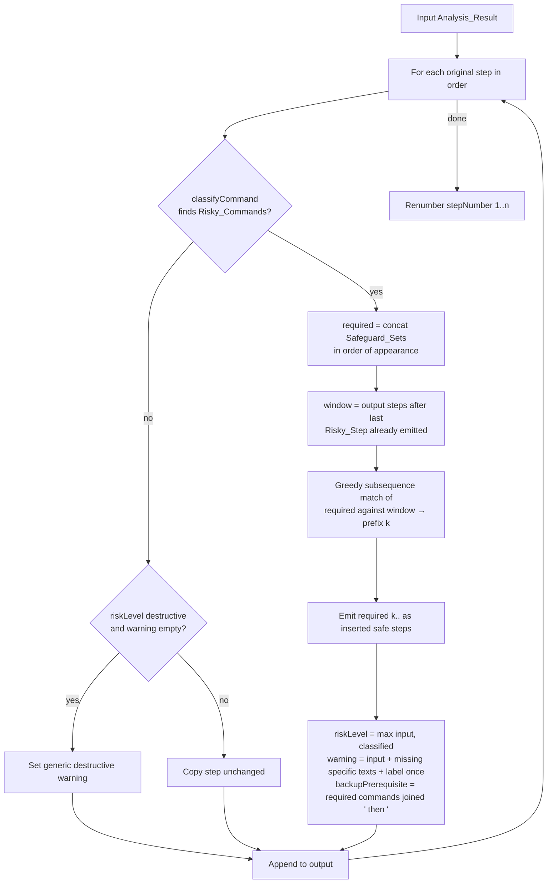

# Design Document: GitPulse Recovery Assistant

## Overview

GitPulse is a single-page React + TypeScript + Vite application that diagnoses common Git incidents from pasted text and presents a safety-first, ordered recovery plan. The core app runs entirely in the browser in Deterministic Fallback / Demo Mode (`fallback_demo`). An optional AWS Lambda handler (`backend/lambda/analyzeIncident.ts`) calls Amazon Bedrock and returns results in Amazon Bedrock AI Mode (`bedrock_ai`).

Every Analysis_Result, from either mode, passes through the Safety_Validator before the Dashboard renders it. The Safety_Validator classifies Risky_Commands by token parsing, raises risk levels (never lowers them), appends command-specific warnings, adds the Residual_Risk_Label, and inserts any missing Safeguard_Steps immediately before each Risky_Step.

GitPulse never executes Git commands, never touches the user's file system or repositories, and never contacts Git remotes. The only network request it can make is a POST of the Incident_Text to the configured Bedrock_Endpoint_URL.

### Implementation priority

1. Implement the shared contract (`src/shared/analysisContract.ts`) and the shell tokenizer, Git command parser/risk classifier, safeguard matchers, and Safety_Validator.
2. Implement focused example-based unit tests for every risky command category (`reset_hard`, `checkout_force`, `clean_force`, `push_force`, `push_force_with_lease`, `branch_force_delete`), safeguard insertion (including the `preserve_changes` matcher examples), risk-level non-downgrade, warning preservation, no safety overclaims, and validator idempotence.
3. Implement the Fallback_Engine and the five Sample_Incidents, with detection and contract (`isAnalysisResult`) tests.
4. Build the Dashboard, copy-only command controls (no run/execute controls), and the localStorage History_Store.
5. Run the full Test_Suite (`vitest --run`), fix failures, and verify `npm run build` (Requirement 23.5).
6. Deploy the static frontend and verify the public URL.
7. Only after the core app is deployed, complete the remaining property-based tests and the optional Bedrock_Handler / Lambda work (with its separate `backend/package.json`) as time permits.

The frontend build and tests must pass with no AWS credentials, no AWS SDK installed, and no `backend/` dependencies installed (Requirement 23.6).

### Key design decisions

| Decision | Choice | Rationale |
|---|---|---|
| Shared contract location | `src/shared/analysisContract.ts` (types + hand-written validator, zero dependencies) | The frontend must not import from `backend/` (Req 23.7). The backend may import from `src/shared/` because its bundler (esbuild) inlines the file. A hand-written validator avoids adding a schema library to both manifests. |
| Risky command detection | Shell-word tokenizer + per-subcommand option parser, no regex over whole command strings | Req 11.1 requires `--force-with-lease` vs `--force`, `-D` vs `-d`, and `-n` vs `-f` to be told apart, including inside short-option groups such as `-fdx`. |
| Multi-match priority (Req 8.4) | `stuck_rebase` > `merge_conflict` > `lost_commits` > `detached_head` > `rejected_push` | A rebase in progress often prints `CONFLICT (` and a detached HEAD. Reflog output often contains `checkout: moving` lines that mention detached states. The more specific incident wins. |
| Safety validation location | Frontend Analyzer, after either engine | Req 11.16 requires one gate for both modes. The Bedrock_Handler does not need to be trusted for safety. |
| Bedrock pre-acceptance checks | Reject Bedrock results whose Risky_Step text contains a Safety_Overclaim_Phrase or contains the Residual_Risk_Label more than once | Req 11.4 (keep input warning unchanged) conflicts with Req 11.6 (label exactly once) and Req 11.22 (zero overclaim phrases) when the input already violates them. Rejecting such responses and using the Fallback_Engine (Req 9.5, 19.3) satisfies all three. |
| `preserve_changes` matcher | Only `git stash` push forms that include untracked files | See "Safeguard Sets and Matchers". A commit can omit untracked files, so no `git commit` form satisfies this safeguard. This follows Req 12.7 and 12.13–12.15. |
| PBT library | [fast-check](https://fast-check.dev/) with Vitest | Mature TypeScript PBT library; integrates directly with Vitest `it`. |

### Research findings

- `git stash` without a subcommand behaves as `git stash push`. Git allows omitting `push` when only options follow, and rejects non-option arguments in that shorthand form ([git-stash documentation](https://git-scm.com/docs/git-stash)).
- `-u` / `--include-untracked` stashes untracked files and then cleans them. `-a` / `--all` also stashes ignored files. `--no-include-untracked` negates `-u`. `-k` / `--keep-index` keeps staged changes in the index while still stashing them. `-p` / `--patch` stashes only selected hunks ([git-stash documentation](https://git-scm.com/docs/git-stash)).
- Git option parsing (parse-options) allows bundled short options such as `-um "msg"`, where `m` consumes the next word (or the rest of the bundle) as its value, and the last of a pair of contradicting options wins.
- `git clean` requires `-f` unless `clean.requireForce` is false; `-n` performs a dry run; `-x` also removes ignored files; `-X` removes only ignored files.
- `git push --force-with-lease` refuses the push only if the remote-tracking ref differs from the remote. A fetch updates the remote-tracking ref, so a fetch without inspection makes the lease pass (the reason Req 14.5 and 14.11 exist).

Content from external sources was rephrased for compliance with licensing restrictions.

## Architecture



### Analysis flow



### Module layout

```
src/
  shared/analysisContract.ts      # types, constants, isAnalysisResult(), isHistoryEntry()
  lib/
    input/validateIncidentText.ts
    fallback/patterns.ts          # trigger patterns + priority order
    fallback/extractors.ts        # evidence extraction (paths, hashes, reflog lines)
    fallback/playbooks.ts         # per-incident step templates
    fallback/fallbackEngine.ts    # analyzeFallback(text): AnalysisResult
    safety/shellTokenizer.ts      # split segments + shell words
    safety/gitCommandParser.ts    # GitInvocation parsing
    safety/riskClassifier.ts      # classifyCommand(command): RiskyCommand[]
    safety/safeguards.ts          # safeguard sets + matchers
    safety/warnings.ts            # warning text constants and builders
    safety/safetyValidator.ts     # validateSafety(result): AnalysisResult
    analyzer/analyzer.ts          # analyze(text, deps): Promise<AnalyzeOutcome>
    analyzer/bedrockClient.ts     # fetch wrapper with timeout
    history/historyStore.ts
  data/sampleIncidents.ts
  components/…                    # see Components and Interfaces
  hooks/useGitPulse.ts
  config.ts                       # reads import.meta.env.VITE_BEDROCK_ENDPOINT_URL
backend/
  package.json                    # @aws-sdk/client-bedrock-runtime, esbuild
  lambda/analyzeIncident.ts
docs/DEPLOYMENT.md
```

The frontend `package.json` lists no AWS SDK packages. An ESLint `no-restricted-imports` rule blocks imports matching `backend/*` and `@aws-sdk/*` from `src/` (Req 23.7), and a test scans `src/` for those import paths.

## Components and Interfaces

### Shared contract (`src/shared/analysisContract.ts`)

```ts
export const SUPPORTED_INCIDENT_TYPES = ['rejected_push','merge_conflict','detached_head','stuck_rebase','lost_commits'] as const;
export type SupportedIncidentType = typeof SUPPORTED_INCIDENT_TYPES[number];
export type IncidentType = SupportedIncidentType | 'unknown';
export type Confidence = 'high' | 'medium' | 'low';
export type Severity = 'low' | 'medium' | 'high';
export type AnalysisMode = 'bedrock_ai' | 'fallback_demo';
export type RiskLevel = 'safe' | 'caution' | 'destructive';
export const RISK_ORDER: Record<RiskLevel, number> = { safe: 0, caution: 1, destructive: 2 };
export const MAX_INCIDENT_CHARS = 20_000;
export const RESIDUAL_RISK_LABEL = 'Risk remains after safeguards';
export const SAFETY_OVERCLAIM_PHRASES = ['now safe','makes it safe','safe to run','completely safe','guarantees safety','fully protected'];

export interface RecoveryStep { stepNumber: number; title: string; explanation: string; command: string;
  riskLevel: RiskLevel; warningMessage?: string; backupPrerequisite?: string; }
export interface AnalysisResult { incidentType: IncidentType; title: string; confidence: Confidence; severity: Severity;
  analysisMode: AnalysisMode; summary: string; detectedEvidence: string[]; assumptions: string[]; recoverySteps: RecoveryStep[]; }

export function isAnalysisResult(value: unknown): value is AnalysisResult; // strict: enums, types, ≥1 step, consecutive numbering from 1, no extra keys
export function containsOverclaim(text: string): boolean;                  // case-insensitive
export function maxRisk(a: RiskLevel, b: RiskLevel): RiskLevel;
```

`isAnalysisResult` rejects unknown keys, non-integer step numbers, and empty `recoverySteps` (Req 9.1–9.4).

### Input validation (`validateIncidentText`)

```ts
type InputValidation = { ok: true } | { ok: false; reason: 'empty' | 'too_long'; message: string };
function validateIncidentText(text: string): InputValidation;
```

- `text.trim().length === 0` → `empty`, message "Incident text is required." (Req 1.4)
- `text.length > 20000` → `too_long`, message "Incident text must be 20,000 characters or fewer." (Req 1.5)
- Otherwise `ok` (Req 1.3). Length counts UTF-16 code units, matching the displayed counter (Req 1.6).

### Fallback_Engine

```ts
function analyzeFallback(text: string): AnalysisResult; // pure, synchronous, analysisMode = 'fallback_demo'
function detectIncidentTypes(text: string): SupportedIncidentType[]; // all matches, in priority order
```

**Trigger patterns** (case-sensitive substring checks unless noted; all linear-time):

| Type | Matches when Incident_Text contains |
|---|---|
| `rejected_push` (Req 3.1) | `[rejected]` AND (`non-fast-forward` OR `fetch first` OR `Updates were rejected`) |
| `merge_conflict` (Req 4.1) | `CONFLICT (` OR `Automatic merge failed` OR `fix conflicts and then commit` |
| `detached_head` (Req 5.1) | `detached HEAD` OR `HEAD detached at` OR `HEAD detached from` |
| `stuck_rebase` (Req 6.1) | `rebase in progress` OR `interactive rebase in progress` OR `git rebase --continue` OR `could not apply` |
| `lost_commits` (Req 7.1) | `reset: moving to` OR `HEAD@{` OR `git reset --hard` OR a lost-commit description (case-insensitive: `lost commit`, `lost my commit`, `commits are gone`, `commits disappeared`, `commit disappeared`, `undo a reset`, `undo reset`) |

**Selection**: `detectIncidentTypes` returns matched types sorted by `PRIORITY = ['stuck_rebase','merge_conflict','lost_commits','detached_head','rejected_push']`. The first is chosen. Every other match adds the assumption `"The text also matches <type>; GitPulse chose <chosen> using its fixed priority order."` (Req 8.4). No match → `unknown` (Req 8.1).

**Evidence extraction** (Req 10.1). Every `detectedEvidence` entry is an exact substring of the Incident_Text:
- The trimmed line containing each matched trigger.
- `merge_conflict`: each line matching `/^.*Merge conflict in (.+)$/m`; the captured path is also added as its own entry (Req 4.2).
- `stuck_rebase`: each `onto <hash>` where hash is `/\b[0-9a-f]{7,40}\b/`; the hash is added as its own entry (Req 6.3).
- `lost_commits`: each line matching `/^[0-9a-f]{7,40} HEAD@\{\d+\}: .*$/m` (Req 7.3).
- Duplicates are removed; order follows first appearance.

**Assumptions** (Req 10.2): playbooks add an assumption for each placeholder they use, for example "The remote is assumed to be `origin` because the output does not name it", "The branch name is not shown, so `<branch>` is a placeholder", "GitPulse cannot see whether you have uncommitted changes".

**Confidence**:
- `unknown` → `low` (Req 8.1).
- Plain-language input (no line matches the terminal-output heuristic: starts with `error:`, `hint:`, `fatal:`, `!`, `To `, `CONFLICT`, `On branch`, `HEAD detached`, `interactive rebase`, `Auto-merging`, `Automatic merge`, or matches the reflog line pattern) → at most `medium` (Req 10.5).
- Fewer than 2 evidence entries → at most `medium` (Req 10.6). Otherwise `high`.
- The Analyzer re-applies the evidence cap to every result, including Bedrock results (Req 10.6 names the Analyzer).

**Severity**: `lost_commits` → `high`; `rejected_push`, `merge_conflict`, `detached_head`, `stuck_rebase` → `medium`; `unknown` → `low`.

**Playbooks** (ordered Recovery_Steps; risk levels before validation):

| Type | Steps |
|---|---|
| `rejected_push` | 1 `git status` (safe) · 2 `git fetch origin` (safe) · 3 `git log --oneline HEAD..origin/<branch>` (safe) · 4 `git pull --rebase origin <branch>` (caution, mention `git merge origin/<branch>` as the alternative in the explanation) · 5 `git push origin <branch>` (safe). Summary explains that the remote branch has commits that the local branch does not have (Req 3.2, 3.3). |
| `merge_conflict` | 1 `git status` · 2 explanation of `<<<<<<<`, `=======`, `>>>>>>>` with command `git diff` · 3 `git add <file>` · 4 `git commit` · 5 `git merge --abort` described as returning to the pre-merge state (caution) (Req 4.3, 4.4). |
| `detached_head` | 1 `git status` · 2 `git switch -c <new-branch-name>` (preserve current commit) · 3 `git log --oneline -n 5` · 4 `git switch <branch>` (changes branch; always after step 2) (Req 5.2). Summary explains that HEAD points to a commit instead of a branch (Req 5.3). |
| `stuck_rebase` | 1 `git status` · 2 `git add <file>` then `git rebase --continue` · 3 `git rebase --skip` (caution) · 4 `git rebase --abort` described as returning to the pre-rebase state (caution) (Req 6.2). |
| `lost_commits` | 1 `git reflog` · 2 `git branch <backup-name> <commit>` · 3 `git log --oneline <backup-name>` (Req 7.2). |
| `unknown` | 1 `git status` · 2 `git log --oneline -n 10` · 3 `git reflog -n 10`, all `safe` (Req 8.2). Assumption: "GitPulse could not match the incident text to a known incident type." (Req 8.3). |

Fallback playbooks contain no Risky_Commands. Risky commands can still arrive from Bedrock, which is why the Safety_Validator covers every rule.

### Sample_Incidents (`src/data/sampleIncidents.ts`)

```ts
interface SampleIncident { id: SupportedIncidentType; label: string; incidentText: string; }
export const SAMPLE_INCIDENTS: readonly SampleIncident[]; // exactly 5, one per type (Req 2.1)
```

Each sample is realistic terminal output that matches only its own type's triggers (Req 2.5).

### Safety_Validator

```ts
function validateSafety(result: AnalysisResult): AnalysisResult; // pure, deterministic, idempotent
```

#### Command parsing

1. **Segmenting** (`shellTokenizer.ts`): split `command` on unquoted `&&`, `||`, `;`, `|`, and newlines. Split each segment into words honoring single quotes, double quotes, and backslash escapes.
2. **Git invocation** (`gitCommandParser.ts`): a segment is a Git invocation if its first word is `git`. Skip global options (`-C <path>`, `-c <k=v>`, `--git-dir=…`, `--work-tree=…`, `--no-pager`, `-P`). The next word is the subcommand.
3. **Options**: words after the su  sbcommand are parsed into `{ longOpts: string[], shortFlags: string[], positionals: string[] }`. `--` ends options; later words are positionals. `--name=value` is stored as `--name` with value. A short group `-abc` expands to flags `a`, `b`, `c`. A per-subcommand table lists short options that take a value (`stash`: `m`; `commit`: `m`, `F`, `C`, `c`; `clean`: `e`; `push`: `o`; `checkout`: `b`, `B`). Such a flag consumes the rest of its group, or the next word if the group ends.

```ts
interface GitInvocation { subcommand: string; words: string[]; longOpts: Map<string, string | true>;
  shortFlags: string[]; positionals: string[]; afterDoubleDash: string[]; }
type RiskyOperation = 'reset_hard' | 'checkout_force' | 'clean_force' | 'push_force' | 'push_force_with_lease' | 'branch_force_delete';
interface RiskyCommand { operation: RiskyOperation; level: RiskLevel; invocation: GitInvocation;
  // operation-specific details:
  clean?: { d: boolean; x: boolean; X: boolean; pathspecs: string[] };
  push?: { remote: string; branch: string; remoteNamed: boolean; branchNamed: boolean };
  branchNames?: string[]; }
function classifyCommand(command: string): RiskyCommand[]; // order of appearance
```

#### Classification rules (Req 11.1, 12–15)

| Operation | Rule on a parsed invocation | Level |
|---|---|---|
| `reset_hard` | subcommand `reset` and long option `--hard` | destructive |
| `checkout_force` | subcommand `checkout` and (`--force` or short flag `f`) | destructive |
| `clean_force` | subcommand `clean` and (`--force` or short flag `f`) | destructive |
| `push_force` | subcommand `push` and (`--force` or short flag `f`) | destructive |
| `push_force_with_lease` | subcommand `push`, `--force-with-lease` (with or without `=<ref>`), no `--force`, no short `f` | caution |
| `branch_force_delete` | subcommand `branch` and (short `D`, or (short `d` or `--delete`) and (short `f` or `--force`)) | destructive |

Not risky: `git clean` with `-n`/`--dry-run` and no `-f`/`--force` (Req 13.8); `git branch -d`/`--delete` without force (Req 15.6); `git push` without force options; `git checkout <branch>`; `git status`. A `git clean -nf` command contains `-f` and is classified destructive; the validator never downgrades on ambiguous flags.

`--force-with-lease` is a distinct long option token, so it never matches `--force`. `-D` and `-d` are distinct flags because flags are case-sensitive. `-n` and `-f` are distinct flags inside `-nd` or `-fd`.

**Push target extraction** (Req 14.7, 14.8): positionals after options. First positional = remote. Second positional = refspec; branch = part after `:` if present, else the whole refspec, with a leading `+` and a `refs/heads/` prefix removed. Missing remote → `origin`; missing branch → `<branch>`.

**Branch names** (Req 15.4): positionals of a `branch_force_delete` invocation. If none are present, the placeholder `<branch>` is used.

#### Validation algorithm



Details:

1. **Risk level** (Req 11.2, 11.3, 11.13, 11.20): `riskLevel = maxRisk(input.riskLevel, max(level of each RiskyCommand))`. Non-risky steps keep their input `riskLevel` (Req 16.11).
2. **Warning** (Req 11.4–11.6, 11.13, 11.21): start with the input `warningMessage` (unchanged, may be empty). For each RiskyCommand in order, for each of its warning texts (see `warnings.ts` below), append the text with a single space separator if the current message does not already contain it. Finally append `Risk remains after safeguards.` if the message does not already contain `RESIDUAL_RISK_LABEL`. Because appends are skipped when text is already present, a second pass changes nothing.
3. **Safeguard window** (Req 11.8, 11.9): the window is the steps already emitted to the output after the most recent emitted Risky_Step (or from the start). The window therefore includes inserted safeguard steps of no earlier Risky_Step, because those were emitted before that earlier Risky_Step.
4. **Prefix match**: walk the window in order with pointer `k` into the required list; when a window step's command satisfies `required[k]`'s matcher, increment `k`. Greedy matching yields the longest leading portion matched as an ordered subsequence. Steps `required[k..]` are inserted immediately before the Risky_Step. When `k` equals the required length, nothing is inserted.
5. **Inserted steps** (Req 11.10): `riskLevel: 'safe'`, the safeguard's `title`, `explanation`, and `command`; no `warningMessage`, no `backupPrerequisite`.
6. **backupPrerequisite** (Req 11.12): the canonical commands of the full required list joined with ` then `, overwriting any input value. Non-risky steps keep their input `backupPrerequisite`.
7. **Generic destructive warning** (Req 11.7): a step with `riskLevel: 'destructive'`, no Risky_Command, and an empty or missing warning gets `GENERIC_DESTRUCTIVE_WARNING`.
8. **Renumbering** (Req 11.11): `stepNumber = index + 1` for every output step.

Inserted safeguard commands are never Risky_Commands (`git status`, `git stash push -u`, `git clean -n…`, `git fetch`, `git log`, `git branch --no-merged`), so they never start a new window.

### Analyzer

```ts
interface AnalyzerDeps { endpointUrl?: string; fetchFn: typeof fetch; timeoutMs: number /* 15000 */; }
interface AnalyzeOutcome { result: AnalysisResult; fallbackReason?: 'bedrock_error' | 'bedrock_invalid' | 'bedrock_timeout'; }
function analyze(text: string, deps: AnalyzerDeps): Promise<AnalyzeOutcome>;
function acceptBedrockResult(value: unknown): AnalysisResult | null;
```

- No endpoint → `analyzeFallback` (Req 19.2).
- Endpoint configured → POST `{ incidentText }` with `Content-Type: application/json` and an `AbortController` that aborts after 15 s (Req 19.1, 19.3).
- `acceptBedrockResult` returns the value only if `isAnalysisResult` passes, `analysisMode === 'bedrock_ai'`, no Risky_Step `title`, `explanation`, or `warningMessage` contains a Safety_Overclaim_Phrase, and no `warningMessage` contains `RESIDUAL_RISK_LABEL` more than once. Otherwise the Analyzer uses the Fallback_Engine with `fallbackReason: 'bedrock_invalid'` (Req 9.5).
- Network errors and non-2xx responses → `bedrock_error`; abort → `bedrock_timeout`.
- Every result then passes through `validateSafety` and the evidence-based confidence cap (Req 11.16, 10.6).
- `analysisMode` is never rewritten. Only an accepted Bedrock response carries `bedrock_ai` (Req 19.5, 19.6).
- If the Fallback_Engine throws (not expected), `analyze` rejects and the Dashboard shows the error state (Req 21.4).

The Analyzer reads only the Incident_Text and calls only `fetchFn` with the configured URL (Req 18.8, 18.9). `config.ts` accepts `VITE_BEDROCK_ENDPOINT_URL` only if it parses as an `https:` URL; otherwise the endpoint is treated as not configured.

### History_Store

```ts
const HISTORY_KEY = 'gitpulse.history.v1';
const MAX_HISTORY = 10;
interface HistoryStore {
  load(): HistoryEntry[];                       // newest first; invalid data → [] and key removed (Req 20.6, 20.7)
  save(entry: HistoryEntry): { entries: HistoryEntry[]; persisted: boolean }; // Req 20.1, 20.2, 20.8
  clear(): void;                                // Req 20.5
}
function createHistoryStore(storage: Pick<Storage,'getItem'|'setItem'|'removeItem'>): HistoryStore;
function addEntry(entries: HistoryEntry[], entry: HistoryEntry): HistoryEntry[]; // pure: prepend, sort by createdAt desc, keep 10
function serializeHistory(entries: HistoryEntry[]): string;
function parseHistory(raw: string | null): HistoryEntry[] | null; // null when invalid
```

`save` catches storage exceptions (quota, private mode) and returns `persisted: false` so the Dashboard can show "History could not be saved." while keeping the current result (Req 20.8).

### Dashboard components

| Component | Responsibility | Requirements |
|---|---|---|
| `App` | 2-column grid at `lg` (≥1024 px), single column below | 22.2, 22.3 |
| `IncidentInputPanel` | Multi-line `<textarea>`, "Analyze Incident" button, reset button, `n / 20,000` counter, inline validation message (`role="alert"`) | 1.1–1.7, 21.2 |
| `SampleIncidentBar` | 5 buttons with `aria-pressed` for the active sample; editing the textarea clears the active sample | 2.1–2.4 |
| `EmptyState`, `LoadingIndicator`, `ErrorState` (with retry) | Interface states | 21.1, 21.2, 21.4 |
| `FallbackNotice` | "Amazon Bedrock was unavailable. This result came from Deterministic Fallback / Demo Mode." when `fallbackReason` is set | 19.4 |
| `AnalysisHeader` | `title`, `summary`, `incidentType`, `severity`, "Confidence: <value>" with "Likely diagnosis, not certain" wording, `ModeBadge` | 10.7, 17.1 |
| `ModeBadge` | `bedrock_ai` → "Amazon Bedrock AI"; `fallback_demo` → "Deterministic Fallback / Demo Mode" | 19.7–19.9 |
| `EvidenceLists` | "Detected Evidence" and "Assumptions" lists with "No entries available." placeholders | 10.3, 10.4 |
| `RecoveryPlan` → `RecoveryStepCard` | Steps sorted by `stepNumber`; number, title, explanation, `RiskBadge`, `ResidualRiskBadge`, `CommandBlock`, `WarningCallout`, `BackupPrerequisite`, `ManualRunReminder` | 17.2–17.5, 11.17–11.19, 11.23 |
| `RiskBadge` | Text label = `riskLevel`; emerald / amber / rose | 17.4, 22.7, 11.23 |
| `ResidualRiskBadge` | Shown when `warningMessage` contains the label | 11.19 |
| `WarningCallout` | Rose for `destructive`, amber for `caution` | 11.17, 11.18 |
| `BackupPrerequisite` | "Run these first: <backupPrerequisite>" | 17.5 |
| `CommandBlock` + `CopyButton` | `<pre><code>` with `select-text`, read-only; copy button with `aria-label="Copy command"`; "Copied" for 2 s; failure message "Copying failed. Select the command text and copy it manually." No run/execute controls | 18.1–18.4, 18.6, 22.6 |
| `ManualRunReminder` | For caution/destructive: "Review this command and its safeguard steps before you run it manually in a terminal." | 18.7 |
| `HistoryPanel` | Entries newest first with title, `ModeBadge`, time; select restores text + result without analysis; clear button; empty message | 19.9, 20.3–20.5, 21.3 |

**Styling** (Req 22): Tailwind `bg-slate-950` page, `bg-slate-900` surfaces, `cyan-400`/`violet-400` accents, `font-mono` for commands. Text colors are chosen from slate-100/200/300 and the 300/400 shades of emerald, amber, rose, which exceed 4.5:1 on slate-900/950. Every control is a native `<button>`/`<textarea>` with `focus-visible:ring-2 ring-cyan-400`. Lucide icons are decorative (`aria-hidden`) inside named buttons.

**State** (`useGitPulse` reducer): `{ text, activeSampleId, validationMessage, status: 'idle'|'loading'|'done'|'error', outcome?, error?, history, historyWarning? }`. Actions: `edit`, `selectSample`, `submit`, `succeeded`, `failed`, `reset`, `selectHistory`, `clearHistory`.

### Bedrock_Handler (optional, `backend/lambda/analyzeIncident.ts`)

```ts
export async function handler(event: APIGatewayProxyEventV2): Promise<APIGatewayProxyResultV2>;
```

- Accepts `POST` with JSON `{ incidentText: string }`; `OPTIONS` returns CORS preflight.
- Missing, empty (whitespace-only), or >20,000-character `incidentText`, or unparsable JSON → 400 `{ "error": "..." }` (Req 24.3).
- Calls `BedrockRuntimeClient` `ConverseCommand` with model ID from `BEDROCK_MODEL_ID` and region from `AWS_REGION`; credentials come from the Lambda execution role (Req 24.5).
- System prompt instructs the model to return only JSON matching the Analysis_Result interface, to put only text found in the input into `detectedEvidence`, to put inferences into `assumptions`, to avoid certainty when evidence is partial, and to include inspection steps before risky commands (Req 24.7).
- Parses the model output, sets `analysisMode: 'bedrock_ai'`, validates with `isAnalysisResult`; any failure → 502 `{ "error": "..." }` (Req 24.2, 24.4).
- CORS headers: `Access-Control-Allow-Origin` = `ALLOWED_ORIGIN` env var, `Access-Control-Allow-Methods: POST, OPTIONS`, `Access-Control-Allow-Headers: Content-Type` (Req 24.8).
- `backend/package.json` declares `@aws-sdk/client-bedrock-runtime` (Req 24.10). `docs/DEPLOYMENT.md` documents the API contract, environment variables, Amplify Hosting steps, and `VITE_BEDROCK_ENDPOINT_URL` (Req 24.9).

## Safeguard Sets and Matchers

Each safeguard has a canonical command (used when inserting and in `backupPrerequisite`) and a matcher (used when checking the Safeguard_Window). A window step satisfies a safeguard if **any** Git invocation in the step's command satisfies the matcher.

```ts
interface SafeguardSpec { id: SafeguardId; command: string; title: string; explanation: string;
  matches(inv: GitInvocation): boolean; }
function safeguardSetFor(risky: RiskyCommand): SafeguardSpec[];
```

### Sets per operation

| Operation | Safeguard_Set (in order) | Canonical commands |
|---|---|---|
| `reset_hard`, `checkout_force` (Req 12.6) | `inspect_status`, `preserve_changes` | `git status`, `git stash push -u` |
| `clean_force` (Req 13.5) | `clean_dry_run` | `git clean -n` + same `d`/`x`/`X` flags (in `d`, `x`, `X` order) + same pathspecs, e.g. `git clean -nd`, `git clean -ndx`, `git clean -nd -- build/` |
| `push_force`, `push_force_with_lease` (Req 14.6–14.8) | `fetch_remote`, `inspect_remote_log` | `git fetch <remote>`, `git log --oneline HEAD..<remote>/<branch>` |
| `branch_force_delete` (Req 15.4) | `inspect_branch_log` (one per branch name), `list_no_merged` | `git log --oneline <branch>`, `git branch --no-merged` |

### Matchers

| Safeguard | Satisfied by |
|---|---|
| `inspect_status` | Any invocation with subcommand `status`. |
| `preserve_changes` | Only a `git stash` push form that includes untracked files. Rules below. |
| `clean_dry_run` (Req 13.6) | Subcommand `clean`, has `-n` or `--dry-run`, has no `-f`/`--force`, the set of `d`/`x`/`X` flags equals the risky command's set, and the set of pathspecs equals the risky command's set. Option order and grouping do not matter. |
| `fetch_remote` (Req 14.9) | Any invocation with subcommand `fetch`. |
| `inspect_remote_log` (Req 14.9) | Subcommand `log` with a positional equal to `HEAD..<remote>/<branch>`. When the branch is the placeholder `<branch>`, any `HEAD..<remote>/<name>` positional matches. |
| `inspect_branch_log` (Req 15.5) | Subcommand `log` with a positional equal to the deleted branch name. |
| `list_no_merged` (Req 15.5) | Subcommand `branch` with long option `--no-merged` (with or without a value). |

### `preserve_changes` matcher for `reset_hard` and `checkout_force`

The safeguard exists to protect uncommitted work, including untracked files, from `git reset --hard` and `git checkout -f`. The matcher accepts a window step only when its command stashes tracked, staged, **and untracked** changes.

**Accepted forms**

- `git stash push -u`
- `git stash push --include-untracked`
- `git stash push -a`
- `git stash push --all`
- Combined short-option groups containing `u` or `a`, such as `git stash push -um "msg"`, `git stash push -ku`, `git stash push -qa`
- The implied-push shorthand, where `push` is omitted and only options follow (per the git-stash documentation): `git stash -u`, `git stash --include-untracked`, `git stash -a`, `git stash --all`, and combined forms such as `git stash -um "msg"`
- Each of the above with the additional options `-k`/`--keep-index`, `--no-keep-index`, `-q`/`--quiet`, `-m <msg>`/`--message=<msg>`/`--message <msg>`

**Rejected forms**

- Any `git commit` command, including `git commit -m "wip"`, `git commit -am "wip"`, and `git commit --all`. A commit records only tracked and staged content and omits untracked files, so it does not preserve the changes that `reset --hard` and `checkout -f` can destroy.
- Plain `git stash` and `git stash push` with no untracked-files option, because they leave untracked files unsaved.
- `git stash save …` (deprecated subcommand; GitPulse recommends only `push` forms), `git stash pop`, `list`, `apply`, `drop`, `clear`, and any other subcommand.
- Forms that stash only part of the changes: `-p`/`--patch`, `-S`/`--staged`, `--pathspec-from-file`, any pathspec positional, or `--` followed by paths.
- Forms where a later `--no-include-untracked` or `--no-all` cancels the earlier untracked option (last option wins, matching git's option parsing).
- Any option outside the allowed list above, because the command would not run as a plain full stash.

**Algorithm**

```
matchesPreserveChanges(inv):
  if inv.subcommand != 'stash': return false
  rest = inv.words after 'stash'
  if rest is empty: return false                       # plain `git stash`
  if rest[0] == 'push': args = rest[1:]
  elif rest[0] starts with '-': args = rest            # implied push
  else: return false                                   # save, pop, list, other
  includeUntracked = false
  for each token in args (left to right, short groups expanded, -m consumes its value):
    '-u' | '--include-untracked' | '-a' | '--all'  → includeUntracked = true
    '--no-include-untracked' | '--no-all'          → includeUntracked = false
    '-k' | '--keep-index' | '--no-keep-index' | '-q' | '--quiet' | '-m' | '--message' → continue
    '--' or any positional or any other option     → return false
  return includeUntracked
```

## Data Models

### Analysis_Result and Recovery_Step

Defined in `src/shared/analysisContract.ts` (see Components and Interfaces). Constraints enforced by `isAnalysisResult`:

| Field | Constraint |
|---|---|
| `incidentType` | One of 5 supported types or `unknown` |
| `confidence` | `high` \| `medium` \| `low` |
| `severity` | `low` \| `medium` \| `high` |
| `analysisMode` | `bedrock_ai` \| `fallback_demo` |
| `title`, `summary` | string |
| `detectedEvidence`, `assumptions` | string[] |
| `recoverySteps` | ≥1 element; `stepNumber` = 1..n consecutive in array order |
| `RecoveryStep.riskLevel` | `safe` \| `caution` \| `destructive` |
| `warningMessage`, `backupPrerequisite` | optional string; key absent rather than `undefined` so JSON round-trip preserves equality |

### History_Entry

```ts
interface HistoryEntry { id: string; incidentText: string; result: AnalysisResult; createdAt: number /* epoch ms */; fallbackReason?: AnalyzeOutcome['fallbackReason']; }
interface StoredHistory { version: 1; entries: HistoryEntry[]; } // JSON under 'gitpulse.history.v1'
```

`parseHistory` requires `version === 1`, an array of at most 10 entries, string `id` and `incidentText`, finite `createdAt`, and `isAnalysisResult(result)`. Any failure discards all stored data (Req 20.7).

### Warning text constants (`src/lib/safety/warnings.ts`)

Each text is a fixed sentence, so tests can assert exact containment. `<remote>`, `<branch>` are substituted from the parsed command.

| Id | Text | Used for |
|---|---|---|
| `RESET_UNCOMMITTED` | "git reset --hard permanently discards all uncommitted changes in the working tree and the staging area." | reset_hard (12.2) |
| `BACKUP_BRANCH_LIMIT` | "A backup branch protects commits but does not protect uncommitted changes." | reset_hard (12.3) |
| `CHECKOUT_FORCE` | "git checkout --force permanently discards local modifications to tracked files when the checkout proceeds." | checkout_force (12.5) |
| `STASH_NOT_GUARANTEE` | "Running git status and git stash push -u first reduces risk but does not guarantee that this command is safe." | reset_hard, checkout_force (12.9) |
| `STASH_IGNORED` | "git stash push -u does not save ignored files; only git stash push -a (--all) includes ignored files." | reset_hard, checkout_force (12.10) |
| `UNPROTECTED_DATA` | "Data the safeguard steps do not capture remains at risk, including files outside the repository, unsaved editor buffers, and stash entries that can later be dropped or cleared." | reset_hard, checkout_force (12.11) |
| `CLEAN_PERMANENT` | "git clean permanently deletes untracked files, and they cannot be recovered with git reflog or git stash." | clean_force (13.2) |
| `CLEAN_X` | "The -x option also permanently deletes ignored files, such as .env files and build outputs." | clean_force with `x` (13.3) |
| `CLEAN_BIG_X` | "The -X option permanently deletes ignored files." | clean_force with `X` (13.4) |
| `PUSH_FORCE_OVERWRITE` | "A force push overwrites the remote branch history and removes commits that teammates pushed and that your local branch lacks." | push_force (14.3) |
| `PUSH_FORCE_LEASE_ADVICE` | "Use git push --force-with-lease instead, and only for a personal branch after a rebase; rewriting a shared branch such as main requires coordination with teammates first." | push_force (14.4) |
| `LEASE_LIMITS` | "git push --force-with-lease still rewrites remote history. The lease protects only against remote commits that have not been fetched yet, and a fetch without inspection makes the lease check pass for commits you have not reviewed." | push_force_with_lease (14.5) |
| `LEASE_CONDITIONS` | "Consider this push only after inspecting the remote changes with git fetch <remote> and git log --oneline HEAD..<remote>/<branch>, confirming that <branch> is the intended target branch, and confirming that your team workflow permits rewriting the branch (the branch is personal or teammates agreed to the rewrite)." | push_force_with_lease (14.11) |
| `BRANCH_REFLOG_LIMIT` | "Unmerged commits on the deleted branch stop being reachable from any branch and stay recoverable through git reflog only for a limited time before Git garbage collection removes them." | branch_force_delete (15.2) |
| `BRANCH_TAG_BACKUP` | "Optional backup before deleting: git tag backup/<branch> <branch>." | branch_force_delete (15.3) |
| `GENERIC_DESTRUCTIVE_WARNING` | "This command can discard work or rewrite history. Inspect the repository state with git status and git log before running it." | Req 11.7 |
| Residual label | "Risk remains after safeguards." (contains `RESIDUAL_RISK_LABEL`) | Req 11.6 |

No constant contains a Safety_Overclaim_Phrase or the Residual_Risk_Label text, except the residual label itself. A unit test enforces this.

### Inserted safeguard step templates

Every explanation ends with "This step reduces risk but does not make the next step safe." (Req 11.10). Reset/checkout safeguards also state that the step "does not protect ignored files or data outside the repository" (Req 12.12).

| Safeguard | Title | Explanation (key content) |
|---|---|---|
| `inspect_status` | "Inspect the working tree" | Lists modified, staged, and untracked files that the next command would affect; does not protect ignored files or data outside the repository. |
| `preserve_changes` | "Save uncommitted and untracked changes" | `git stash push -u` saves tracked, staged, and untracked non-ignored changes; ignored files are not saved; `git stash pop` restores the saved changes; does not protect ignored files or data outside the repository (Req 12.8, 12.12). |
| `clean_dry_run` | "Preview which files would be deleted" | The dry run lists the files that the cleanup command would delete and deletes no files (Req 13.7). |
| `fetch_remote` | "Fetch the latest remote state" | Downloads commits from `<remote>` without changing local branches so they can be inspected next. |
| `inspect_remote_log` | "Inspect commits that exist only on the remote" | Each listed commit exists only on the remote and will be removed from the remote branch by the force push (Req 14.10). |
| `inspect_branch_log` | "Review commits on `<branch>`" | Shows the commits on `<branch>` that deletion could make unreachable. |
| `list_no_merged` | "List branches with unmerged commits" | Shows branches whose commits are not merged into the current branch; if `<branch>` appears, deleting it loses those commits from every branch. |

## Correctness Properties

*A property is a characteristic or behavior that should hold true across all valid executions of a system-essentially, a formal statement about what the system should do. Properties serve as the bridge between human-readable specifications and machine-verifiable correctness guarantees.*

Reflection on redundancy: overlapping criteria were merged. Risk-level criteria (11.2, 11.3, 11.20, 14.12) form one no-downgrade property. Warning criteria from Requirements 11–15 form one warning-completeness property. Safeguard insertion criteria (11.8, 11.9, 12.6) form one insertion property, with separate properties only where a matcher has its own logic (preserve_changes, clean dry run, push, branch). UI, configuration, and deployment criteria are covered by example and smoke tests in the Testing Strategy.

### Property 1: Incident text validation

*For any* string `s`, `validateIncidentText(s)` returns `ok` if and only if `s` contains at least 1 non-whitespace character and `s.length <= 20000`; whitespace-only or empty strings return `empty`, and longer strings return `too_long`.

**Validates: Requirements 1.3, 1.4, 1.5**

### Property 2: Trigger detection

*For any* supported incident type `T`, any trigger snippet of `T`, and any surrounding noise text that contains no trigger of another type, `analyzeFallback` returns `incidentType` equal to `T`.

**Validates: Requirements 3.1, 4.1, 5.1, 6.1, 7.1**

### Property 3: Fixed priority resolution

*For any* non-empty subset of supported incident types, combining one trigger snippet per type (in any order, with noise) makes `analyzeFallback` return the highest-priority type of the subset, and `assumptions` names every other type in the subset.

**Validates: Requirements 8.4**

### Property 4: Unknown incidents are safe and low confidence

*For any* text that contains no trigger of any supported type, `analyzeFallback` returns `incidentType` `unknown`, `confidence` `low`, only `safe` Recovery_Steps, and an assumption stating that the text could not be matched to a known incident type.

**Validates: Requirements 8.1, 8.2, 8.3**

### Property 5: Playbook content per incident type

*For any* text classified as type `T`, the Recovery_Step commands contain the commands required for `T` in the required order (rejected push: `git status`, `git fetch`, `git pull --rebase` or `git merge`, then `git push`; merge conflict: `git status`, conflict marker explanation, `git add`, `git commit`, and a `git merge --abort` step; detached HEAD: `git switch -c` or `git branch <name>` before any branch-changing step; stuck rebase: `git status`, `git rebase --continue`, `git rebase --abort`; lost commits: `git reflog`, `git branch <backup> <commit>`, `git log`), and the `summary` contains the type's required explanation.

**Validates: Requirements 3.2, 3.3, 4.3, 4.4, 5.2, 5.3, 6.2, 7.2**

### Property 6: Evidence is grounded in the input

*For any* Incident_Text, every entry in the Fallback_Engine's `detectedEvidence` is a substring of the Incident_Text.

**Validates: Requirements 10.1**

### Property 7: Entity extraction

*For any* generated conflicted file paths, commit hashes, and reflog lines embedded in matching output (`Merge conflict in <path>`, `onto <hash>`, `<hash> HEAD@{n}: <message>`), every path, every hash, and every reflog line appears in `detectedEvidence`.

**Validates: Requirements 4.2, 6.3, 7.3**

### Property 8: Confidence is capped by evidence

*For any* Analysis_Result returned by the Analyzer (from either mode), if `detectedEvidence` has fewer than 2 entries then `confidence` is not `high`; and *for any* plain-language Incident_Text without terminal-output lines, the Fallback_Engine's `confidence` is `medium` or `low`.

**Validates: Requirements 10.5, 10.6**

### Property 9: Analyzer output is well-formed

*For any* Incident_Text accepted by input validation, the Analyzer in fallback mode returns a result that passes `isAnalysisResult`, has `analysisMode` `fallback_demo`, has at least 1 Recovery_Step, and numbers steps 1..n consecutively.

**Validates: Requirements 9.1, 9.2, 9.3, 9.4, 19.5**

### Property 10: Analysis_Result JSON round trip

*For any* valid Analysis_Result `r`, `JSON.parse(JSON.stringify(r))` is deeply equal to `r` and still passes `isAnalysisResult`.

**Validates: Requirements 9.6**

### Property 11: Invalid Bedrock responses fall back

*For any* Bedrock response that fails `acceptBedrockResult` (arbitrary JSON, contract violations, wrong `analysisMode`, overclaim phrases in Risky_Steps, duplicated Residual_Risk_Label) and *for any* error status, the Analyzer returns `validateSafety(analyzeFallback(text))` (after the confidence cap) with `analysisMode` `fallback_demo` and a `fallbackReason`; `bedrock_ai` appears only when the response is accepted.

**Validates: Requirements 9.5, 19.3, 19.6, 11.16**

### Property 12: Risky command classification matches the reference model

*For any* command generated from a grammar of Git invocations (reset, checkout, clean, push, branch, stash, status, log, fetch, commit) with random option ordering, short-option grouping, quoting, global options, and multiple segments joined by `&&`, `;`, or `|`, `classifyCommand` returns exactly the Risky_Commands, in order of appearance, that the reference rule table yields; in particular `--force-with-lease` alone is `caution`, `-d` alone and `-n` alone are not risky.

**Validates: Requirements 11.1, 11.13, 12.1, 12.4, 13.1, 13.8, 14.1, 14.2, 15.1, 15.6**

### Property 13: Risk level never decreases

*For any* Analysis_Result and any Safeguard_Window content (empty, partial, or complete), each original step's output `riskLevel` equals `maxRisk(input riskLevel, classified level)`; for Risky_Steps this is `caution` or `destructive`, and for steps without a Risky_Command it equals the input `riskLevel`.

**Validates: Requirements 11.2, 11.3, 11.20, 14.12**

### Property 14: Warnings are preserved and complete

*For any* Risky_Step with any input `warningMessage` (containing the Residual_Risk_Label at most once) and any Safeguard_Window content, the output `warningMessage` contains the input text unchanged, contains every command-specific warning text for every contained Risky_Command (including `-x` and `-X` texts and substituted remote/branch names), and contains the Residual_Risk_Label exactly once; *for any* non-risky step with a non-empty input warning, the output contains the input text unchanged.

**Validates: Requirements 11.4, 11.5, 11.6, 11.13, 11.21, 12.2, 12.3, 12.5, 12.9, 12.10, 12.11, 13.2, 13.3, 13.4, 14.3, 14.4, 14.5, 14.11, 14.12, 15.2, 15.3**

### Property 15: No safety overclaims

*For any* Analysis_Result whose Risky_Step input warnings contain no Safety_Overclaim_Phrase, every output Risky_Step `warningMessage` and every inserted Safeguard_Step `explanation` contains zero Safety_Overclaim_Phrases (case-insensitive).

**Validates: Requirements 11.22**

### Property 16: Safeguard insertion is complete and minimal

*For any* Analysis_Result, after validation each Risky_Step's Safeguard_Window contains its full required Safeguard_Set as an ordered subsequence; and the steps inserted before each Risky_Step are exactly `required[k..]`, where `k` is the length of the longest leading portion of the required set found as an ordered subsequence in the input window (zero inserted when `k` equals the set length).

**Validates: Requirements 11.8, 11.9, 11.13, 12.6**

### Property 17: Inserted safeguard steps are well-formed

*For any* inserted Safeguard_Step, `riskLevel` is `safe`, `title` and `explanation` are non-empty, the explanation states that the step reduces risk but does not make the next step safe, and the explanation contains the kind-specific statement (stash: saves tracked, staged, and untracked non-ignored changes, ignored files not saved, `git stash pop` restores; reset/checkout safeguards: does not protect ignored files or data outside the repository; dry run: lists files and deletes none; remote log: listed commits exist only on the remote and will be removed).

**Validates: Requirements 11.10, 12.8, 12.12, 13.7, 14.10**

### Property 18: Renumbering and backup prerequisites

*For any* validated Analysis_Result, `stepNumber` values are 1..n in array order, and every Risky_Step's `backupPrerequisite` equals the canonical commands of its required Safeguard_Set joined with ` then `.

**Validates: Requirements 11.11, 11.12**

### Property 19: Safety validation is idempotent

*For any* Analysis_Result `r` (from either Analysis_Mode), `validateSafety(validateSafety(r))` is deeply equal to `validateSafety(r)`.

**Validates: Requirements 11.14, 16.12**

### Property 20: preserve_changes matcher accepts only untracked-inclusive stash push forms

*For any* parsed Git invocation `inv`, the `preserve_changes` safeguard of `reset_hard` and `checkout_force` is satisfied by `inv` if and only if `inv` is a `git stash push` form (explicit `push`, or the implied-push shorthand `git stash <options>`) whose final untracked-files state is enabled by `-u`, `--include-untracked`, `-a`, `--all`, or a combined short-option group containing `u` or `a` (for example `-um "msg"`), with only the allowed additional options (`-k`, `--keep-index`, `--no-keep-index`, `-q`, `--quiet`, `-m`/`--message`) and no pathspec, `--patch`, `--staged`, or `--pathspec-from-file`. No `git commit` invocation of any form satisfies this safeguard, and neither does plain `git stash` or `git stash push` without an untracked-files option. Consequently, *for any* window containing `git status` followed only by `git commit` forms or non-untracked stash forms, the Safety_Validator inserts the `git stash push -u` Safeguard_Step before the Risky_Step.

**Validates: Requirements 12.6, 12.7, 12.13, 12.14, 12.15**

### Property 21: Original steps keep order and content

*For any* Analysis_Result, removing the inserted Safeguard_Steps from the validated output yields the original steps in their original order, with every field equal to the input except `stepNumber`, a `riskLevel` that is equal or more severe, a `warningMessage` that has the input as a prefix, and `backupPrerequisite` on Risky_Steps.

**Validates: Requirements 11.15**

### Property 22: Clean dry-run safeguard matches the destructive command

*For any* `git clean` Destructive_Command with any combination of `d`, `x`, `X` flags, option grouping, and pathspecs, the generated dry-run command contains `-n`, no `-f`, the same `d`/`x`/`X` set and the same pathspecs, and is accepted by the `clean_dry_run` matcher; and *for any* `git clean` command that differs in its `d`/`x`/`X` set or pathspecs, or contains `-f`/`--force`, or lacks `-n`/`--dry-run`, the matcher rejects it.

**Validates: Requirements 13.5, 13.6**

### Property 23: Push safeguards use the push target

*For any* `git push` Risky_Command with an optional remote and optional refspec, the inserted Safeguard_Steps are `git fetch <remote>` and `git log --oneline HEAD..<remote>/<branch>`, using the named remote and branch when present and `origin` and `<branch>` when omitted; any `git fetch` command satisfies the fetch safeguard, and a `git log` command satisfies the inspection safeguard if and only if it contains the matching `HEAD..<remote>/<branch>` range.

**Validates: Requirements 14.6, 14.7, 14.8, 14.9**

### Property 24: Branch deletion safeguards use the branch name

*For any* `git branch` Destructive_Command deleting branch `b`, the required Safeguard_Set is `git log --oneline b` followed by `git branch --no-merged`; any `git log` naming `b` satisfies the first and any `git branch --no-merged` satisfies the second, while a `git log` that does not name `b` does not.

**Validates: Requirements 15.4, 15.5**

### Property 25: Unclassified destructive steps get a warning

*For any* Recovery_Step with `riskLevel` `destructive`, no Risky_Command, and an empty or missing `warningMessage`, the output `warningMessage` is non-empty and equals `GENERIC_DESTRUCTIVE_WARNING`; with a non-empty input warning, the warning is unchanged.

**Validates: Requirements 11.7**

### Property 26: History is capped and ordered

*For any* sequence of saved History_Entries, the stored list has at most 10 entries, contains the most recent `min(n, 10)` entries, and is sorted by `createdAt` descending.

**Validates: Requirements 20.1, 20.2, 20.3**

### Property 27: History round trip

*For any* valid list of at most 10 History_Entries, `parseHistory(serializeHistory(list))` is deeply equal to the list, and a new store created over the same storage loads the same list.

**Validates: Requirements 20.6, 20.9**

### Property 28: Invalid stored history is discarded

*For any* stored value that is not valid JSON or fails history validation (wrong version, more than 10 entries, malformed entries, invalid Analysis_Results), `load()` returns an empty list and removes the stored key.

**Validates: Requirements 20.7**

## Error Handling

| Condition | Handling | Requirement |
|---|---|---|
| Empty / whitespace-only input | Inline validation message, Analyzer not called | 1.4 |
| Input over 20,000 characters | Inline validation message with the limit, Analyzer not called | 1.5 |
| Bedrock endpoint not configured or not `https:` | Use Fallback_Engine; no notice (normal demo mode) | 19.2 |
| Bedrock network error or non-2xx status | Fallback_Engine, `fallbackReason: 'bedrock_error'`, Dashboard notice | 19.3, 19.4 |
| Bedrock response not JSON, fails contract, or fails pre-acceptance checks | Fallback_Engine, `fallbackReason: 'bedrock_invalid'`, notice | 9.5, 19.3, 19.4 |
| Bedrock no response in 15 s | `AbortController` aborts; Fallback_Engine, `fallbackReason: 'bedrock_timeout'`, notice | 19.3, 19.4 |
| Fallback_Engine or Safety_Validator throws | `analyze` rejects; Dashboard error state with message and retry | 21.4 |
| Clipboard API missing or write rejects | "Copying failed. Select the command text and copy it manually." | 18.4 |
| `localStorage` read fails or data invalid | Start with empty history; remove the bad key (removal errors ignored) | 20.7 |
| `localStorage` write fails | Keep current result displayed; show "History could not be saved." | 20.8 |
| Lambda: bad body | 400 JSON error | 24.3 |
| Lambda: Bedrock error or invalid model output | 502 JSON error | 24.4 |
| Command text the tokenizer cannot fully parse (for example an unclosed quote) | Tokenize the remainder as one word; classification stays conservative and never lowers the input `riskLevel` | 11.2 |

Error messages never include AWS credentials, request headers, or stack traces.

## Testing Strategy

### Tools

- **Vitest** for all tests (`vitest --run` in CI), with **jsdom** and **@testing-library/react** for component tests.
- **fast-check** for property-based tests. Each property test uses `fc.assert(fc.property(...), { numRuns: 100 })` or higher.
- Each correctness property is implemented by a **single** property-based test, tagged with a comment in this format:
  `// Feature: gitpulse-recovery-assistant, Property 20: preserve_changes matcher accepts only untracked-inclusive stash push forms`
- Tests run with no AWS credentials, no AWS SDK installed, and no `backend/` dependencies installed (Req 23.6). Backend tests live under `backend/` and run with the backend's own manifest.

### Test execution order

Tests are written in the order of the Implementation priority steps in the Overview:

| Step | Tests written |
|---|---|
| 2 | Safety_Validator, classifier, and matcher example tests: the Requirement 16 table, the `preserve_changes` matcher examples, and the classifier edge examples |
| 3 | Fallback_Engine and contract (`isAnalysisResult`) tests |
| 4 | Component, History_Store, and Analyzer example tests, plus the smoke and static checks |
| 5 | Full suite (`vitest --run`) and `npm run build` |
| 7 | Remaining property tests (Properties 1–28 not already covered) and the optional backend tests |

This sequencing changes when tests are written, not whether they are written. All 28 correctness properties and all listed example, smoke, and static tests remain required coverage, and no safety behavior is relaxed. The step-2 example tests cover the same safety behaviors as Properties 12–20, so core safety is verified before deployment.

### Generators (fast-check arbitraries)

- `arbIncidentText`: random noise lines plus optional trigger snippets per type.
- `arbGitCommand`: grammar-based Git invocations with shuffled options, grouped short flags (`-fdx`, `-um`), quoted values, global options, and joined segments; paired with a reference classifier.
- `arbStashCommand`: accepted and rejected `git stash` forms, plus `git commit` forms, with expected `preserve_changes` result.
- `arbRecoveryStep` / `arbAnalysisResult`: valid contract values for both Analysis_Modes, with random Risky_Steps and random partial safeguard windows.
- `arbHistoryEntries`: 0–10 entries with distinct `createdAt` values.

### Property tests

Properties 1–28 above, one test each, at least 100 runs. Properties 11 and 23 use a mocked `fetchFn`; no real network calls are made. Property tests not already written are completed in step 7 of the Test execution order.

### Example-based unit tests

**Safety_Validator (Requirement 16)**, each run for `analysisMode` `fallback_demo` and `bedrock_ai` (16.12):

| Test | Input command(s) | Expected |
|---|---|---|
| 16.1 | `git reset --hard HEAD~1` | `destructive`; `RESET_UNCOMMITTED`, `BACKUP_BRANCH_LIMIT`; `git status`, `git stash push -u` inserted immediately before; label |
| 16.2 | `git clean -f`, `-fd`, `-fx`, `-fdx` | `destructive`; `CLEAN_PERMANENT`; `CLEAN_X` for `-x` variants; `git clean -n`, `-nd`, `-nx`, `-ndx` immediately before; label |
| 16.3 | `git push --force origin feature`, `git push -f origin feature` | `destructive`; `PUSH_FORCE_OVERWRITE`, `PUSH_FORCE_LEASE_ADVICE`; `git fetch origin`, `git log --oneline HEAD..origin/feature`; label |
| 16.4 | `git push --force-with-lease origin feature` | `caution`; `LEASE_LIMITS`; same push safeguards; label |
| 16.5 | `git checkout -f main` | `destructive`; `CHECKOUT_FORCE`; `git status`, `git stash push -u`; label |
| 16.6 | `git branch -D feature` | `destructive`; `BRANCH_REFLOG_LIMIT`, `BRANCH_TAG_BACKUP`; `git log --oneline feature`, `git branch --no-merged`; label |
| 16.7 | Each of the above with input `safe`; lease with input `destructive` | `caution`/`destructive`; lease stays `destructive` |
| 16.8 | Each with non-empty input warning | Input warning text unchanged in output |
| 16.9 | Each | Validating twice equals validating once |
| 16.10 | Complete window; window with only the leading safeguard | Zero inserted; only the remaining safeguard inserted |
| 16.11 | `git clean -nd`, `git status`, `git branch -d feature`, `git push origin feature`, `git checkout main` | Not risky, input `riskLevel` kept, zero inserted |
| 16.13 | Each with complete window and non-empty warning | Classified (or more severe input) level, input warning, full specific text, label |
| 16.14 | `git reset --hard HEAD~1`, `git checkout -f main` | `STASH_NOT_GUARANTEE`, `STASH_IGNORED`, `UNPROTECTED_DATA`; inserted stash explanation states ignored files are not saved |
| 16.15 | `git push --force-with-lease origin feature` | `LEASE_CONDITIONS` with `origin`/`feature` (inspect remote, confirm target branch, team workflow) |
| 16.16 | Each | Zero Safety_Overclaim_Phrases in warnings and inserted explanations |

**`preserve_changes` matcher examples** (window contains `git status` then the listed command, followed by `git reset --hard HEAD~1`; repeated with `git checkout -f main`):

| Window command | Matches | Expected inserted steps |
|---|---|---|
| `git stash push -u` | yes | none |
| `git stash push --include-untracked` | yes | none |
| `git stash push -a` | yes | none |
| `git stash push --all` | yes | none |
| `git stash push -um "wip"` | yes | none |
| `git stash push -ku` | yes | none |
| `git stash push -u -m "wip"` | yes | none |
| `git stash -u` | yes | none |
| `git stash --include-untracked` | yes | none |
| `git stash -a` | yes | none |
| `git stash --all` | yes | none |
| `git stash -um "wip"` | yes | none |
| `git commit -m "wip"` | no | `git stash push -u` |
| `git commit -am "wip"` | no | `git stash push -u` |
| `git stash` | no | `git stash push -u` |
| `git stash push` | no | `git stash push -u` |
| `git stash push -m "wip"` | no | `git stash push -u` |
| `git stash push -u --no-include-untracked` | no | `git stash push -u` |
| `git stash push -u -- src/` | no | `git stash push -u` |
| `git stash push -p -u` | no | `git stash push -u` |
| `git stash save -u` | no | `git stash push -u` |

A further example checks that a window with only `git commit -am "wip"` (no `git status`) receives both `git status` and `git stash push -u`.

**Classifier edge examples**: `git push --force-with-lease=main origin main` (caution), `git push origin main --force-with-lease -f` (destructive), `git branch -d -f old` and `git branch --delete --force old` (destructive), `git clean -nf` (destructive), `git -C repo reset --hard` (destructive), `git reset --hard && git clean -fdx` (both, concatenated safeguards in order), `git commit -m "--force"` (not risky).

**Fallback_Engine**: each Sample_Incident yields its type (2.5); placeholder assumptions appear for `rejected_push` (10.2); a 20,000-character worst-case input completes in under 500 ms in the test runner as a regression guard (21.5).

**Analyzer**: no endpoint → fallback (19.2); endpoint configured → one POST to that URL only, with `{ incidentText }` (19.1, 18.9); fake-timer 15 s timeout → fallback with `bedrock_timeout` (19.3); accepted Bedrock result passes through `validateSafety` (11.16).

**History_Store**: write failure returns `persisted: false` (20.8); `clear` removes the key (20.5).

**Components** (Testing Library): validation messages and counter (1.4–1.6); reset (1.7); sample buttons and `aria-pressed` (2.1–2.4); empty, loading, error, and empty-history states (21.1–21.4); header, confidence wording, evidence placeholders (10.3, 10.4, 10.7, 17.1); step order and card contents (17.2, 17.3); badge text and color classes, residual badge, warning callouts, backup prerequisite label, manual-run reminder, no overclaim text for Risky_Steps (11.17–11.19, 11.23, 17.4, 17.5, 18.7, 22.7); copy success with fake timers, copy failure, read-only command with no run controls, accessible copy-button name (18.1–18.4, 18.6, 22.6); mode badge texts and fallback notice, including history reloads (19.4, 19.7–19.9); history select and clear (20.4, 20.5); layout classes `lg:grid-cols-2` and single column default (22.2, 22.3); palette contrast ratio ≥ 4.5:1 computed for each text/background token pair (22.4); keyboard tab order and `focus-visible` classes (22.5).

### Smoke and static checks

- `vite build` succeeds with no AWS environment variables (23.1, 23.6).
- A test scans `src/` for imports of `backend/`, `@aws-sdk/`, `child_process`, and `fs`, and for `fetch` calls other than in `bedrockClient.ts` (18.5, 18.8, 23.7).
- A test asserts the frontend `package.json` lists no `@aws-sdk/*`, database, or auth packages (23.3, 24.10).
- A post-build check scans `dist/` for AWS access key patterns (`AKIA[0-9A-Z]{16}`) (24.6).
- `docs/DEPLOYMENT.md` exists and contains the API contract, environment variables, Amplify steps, and `VITE_BEDROCK_ENDPOINT_URL` sections (24.9).

### Backend tests (optional, `backend/`)

With a mocked `BedrockRuntimeClient`: valid request returns 200 with `bedrock_ai` (24.2); missing, empty, and over-length `incidentText` return 400 (24.3); Bedrock error and invalid model output return 502 (24.4); CORS headers use `ALLOWED_ORIGIN` (24.8); the system prompt contains the contract, evidence/assumption separation, and no-certainty instructions (24.7).

### Why some criteria are not property tests

UI rendering, layout, clipboard behavior, timers, deployment, and AWS wiring do not vary meaningfully with input, or they depend on external services. These use example, integration (mocked), or smoke tests as listed above.
